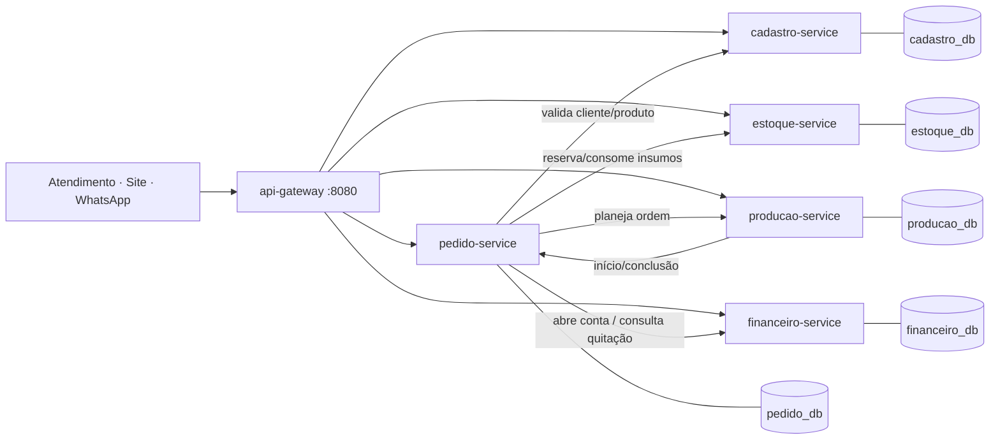
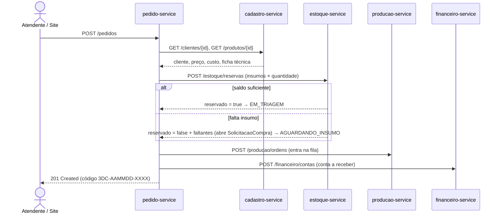
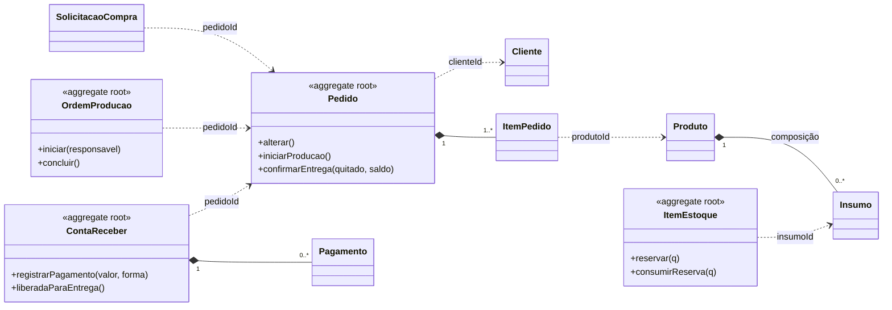

# 3D Control — Sistema de Controle de Vendas

Backend do **3D Control**, sistema que centraliza a operação de uma pequena empresa de produtos
personalizados sob encomenda: pedidos vindos de qualquer canal (WhatsApp, Instagram, Facebook, telefone,
site e balcão) passam a seguir **um fluxo único e rastreável**, integrando vendas, estoque de insumos,
produção e financeiro.

> **UNIESP — Sistemas para Internet · Tecnologia para Back-end Avançado · 2026.2**
> Professor: Jonas Bernadino de Lima
> Grupo: Alexandre Chaves Martins · Hrasam Hussein Gomes Monteiro · Luana Silva · Victor Melquiades Leite

> **Esta é a versão com Arquitetura Limpa** (camadas `domain` / `application` / `infrastructure`, portas e
> adaptadores). A versão simplificada, com Controller → Service → Repository e as mesmas funcionalidades,
> está em [acmartins714/3DControl](https://github.com/acmartins714/3DControl).

---

## Sumário

1. [Problema e escopo da primeira versão](#1-problema-e-escopo-da-primeira-versão)
2. [Arquitetura escolhida e justificativa](#2-arquitetura-escolhida-e-justificativa)
3. [Microsserviços](#3-microsserviços)
4. [Organização do código (Package by Feature + Arquitetura Limpa)](#4-organização-do-código-package-by-feature--arquitetura-limpa)
5. [Fluxos principais](#5-fluxos-principais)
6. [Diagrama de classes UML](#6-diagrama-de-classes-uml)
7. [Tecnologias](#7-tecnologias)
8. [Como executar (roteiro de inicialização)](#8-como-executar)
9. [Endpoints](#9-endpoints)
10. [Limitações conhecidas e próximos passos](#10-limitações-conhecidas-e-próximos-passos)

---

## 1. Problema e escopo da primeira versão

A proposta comercial identificou cinco causas-raiz de prejuízo. Cada uma tem uma resposta direta no sistema:

| Problema diagnosticado | Resposta no 3D Control | Onde está no código |
|---|---|---|
| Dados espalhados em celulares, cadernos e planilhas | Cadastros únicos de clientes, produtos e insumos; todo pedido registrado num só lugar, com o canal de origem e o atendente | `cadastro-service`, `pedido-service` |
| Alterações do cliente não chegam à produção | **Regra de Ouro**: o pedido pode ser alterado até entrar em produção e é bloqueado depois disso. A produção nunca guarda uma cópia das especificações: consulta sempre o pedido | `Pedido.garantirAlteravel()`, `StatusPedido.permiteAlteracao()` |
| Produção parada por falta de insumo / compras em excesso | Cada pedido reserva os insumos da ficha técnica do produto. Se faltar algo, nada é reservado, o pedido fica *Aguardando insumo* e a administração recebe uma **solicitação de compra** antes do início da fabricação | `ReservarInsumosUseCase`, `SolicitacaoCompra` |
| Prazos prometidos sem visibilidade / ninguém sabe o status | Fila de produção ordenada por disponibilidade de insumo e proximidade do prazo; **rastreio** por código com a linha do tempo completa | `FilaProducao`, `RastrearPedidoUseCase` |
| Entrega sem conferir o pagamento / sem visão de lucro | Conta a receber por pedido (sinal, parcelas, quitação). **A entrega é bloqueada enquanto houver saldo.** Lucratividade calculada por categoria de produto | `ContaReceber`, `Pedido.confirmarEntrega()`, `AnaliseLucratividade` |

**Fora da primeira versão** (planejado, ver [§10](#10-limitações-conhecidas-e-próximos-passos)): integração
automatizada com a API do WhatsApp (o endpoint de rastreio já está pronto para ela), o front-end, a
autenticação de funcionários e o cálculo de capacidade produtiva por dia.

---

## 2. Arquitetura escolhida e justificativa

O projeto combina três decisões complementares:

```
 Microsserviços          → como o SISTEMA é dividido     (um serviço por área de negócio)
 Package by Feature      → como cada SERVIÇO é dividido  (um pacote por funcionalidade)
 Arquitetura Limpa       → como cada FEATURE é dividida  (domain / application / infrastructure)
```

### 2.1 Microsserviços

O sistema é dividido em **cinco serviços de negócio + um API Gateway**. Cada serviço corresponde a um
*bounded context* (contexto delimitado, no vocabulário do DDD) e cada contexto, a um dos módulos da
proposta comercial.

**Por que microsserviços neste caso:**

- **O problema é de integração entre áreas.** A empresa perde dinheiro na passagem de informação entre
  atendimento, produção, estoque e financeiro. Separar o sistema exatamente nessas fronteiras deixa as
  integrações **explícitas e contratuais** (APIs REST versionáveis), em vez de acoplamentos escondidos
  dentro de um monólito.
- **Fonte única de verdade por assunto.** Cada serviço é **dono exclusivo dos seus dados**
  (*database per service*): só o `pedido-service` altera pedidos, só o `financeiro-service` decide se um
  pedido está quitado. Isso elimina a causa do problema original: várias cópias divergentes da mesma
  informação.
- **Evolução e implantação independentes.** O módulo financeiro (relatórios de lucratividade) e o canal
  automatizado (site e WhatsApp) tendem a mudar em ritmos diferentes. Cada serviço pode ser alterado,
  testado e publicado sem redeploy dos demais.
- **Escala seletiva.** Em datas comemorativas o volume de pedidos e consultas de rastreio cresce muito
  mais que o de lançamentos financeiros. Só os serviços sob pressão precisam de mais instâncias.
- **Isolamento de falhas.** Uma instabilidade no relatório financeiro não impede a produção de consultar
  a fila.
- **Objetivo pedagógico da disciplina** (Back-end Avançado): exercitar comunicação entre serviços,
  gateway, consistência distribuída e conteinerização.

**Cuidados para manter a solução simples** (premissa do proprietário: orçamento de pequena empresa):

- Granularidade **grossa**: cinco serviços, um por módulo da proposta, e não um por entidade.
- **Um único PostgreSQL** com **um banco por serviço** (`cadastro_db`, `pedido_db`, ...): mantém o
  isolamento lógico sem custo de várias instâncias. Se for preciso, um banco pode migrar para outro
  servidor sem mudar código.
- Comunicação **síncrona via REST** (`RestClient`), sem broker de mensagens nesta versão. Menos
  infraestrutura para operar; a evolução para eventos está prevista (§10).
- Tudo sobe com **um comando** (`docker compose up`).

**Comunicação e consistência.** O `pedido-service` atua como **orquestrador** do fluxo do pedido. Ao
registrar um pedido, ele valida o cliente e os produtos, reserva insumos, inclui a ordem na fila e abre
a conta a receber. Se uma etapa falhar depois de efeitos em outros serviços, ele executa
**compensações** (libera a reserva, cancela a ordem e a conta), no padrão *Saga orquestrada*.
Referências entre serviços são feitas **apenas por identificador (UUID)**; não há chave estrangeira entre
bancos.

**API Gateway.** O `api-gateway` (Spring Cloud Gateway) é o ponto único de entrada (`:8080/api/**`) para
o front-end, o site e o bot do WhatsApp. Os clientes não precisam conhecer o endereço de cada serviço.
Autenticação, *rate limiting* e CORS ficam centralizados num só lugar quando forem adicionados.

### 2.2 Package by Feature

Dentro de cada serviço, o código é agrupado **por funcionalidade de negócio** (`cliente`, `produto`,
`insumo`, `pedido`, `rastreio`, `estoque`, `solicitacaocompra`, `ordemproducao`, `contareceber`,
`lucratividade`), e **não** por tipo técnico (`controllers/`, `services/`, `repositories/`).

**Por quê:**

- **Alta coesão:** tudo o que diz respeito a "pedido" está em `pedido/`. Para entender ou alterar uma
  regra, abre-se um único pacote.
- **Baixo acoplamento e encapsulamento:** classes de infraestrutura são *package-private* (adaptadores
  JPA, controllers, DTOs). Outra feature só enxerga o que é deliberadamente público (domínio e casos de
  uso).
- **O código "grita" o negócio** (*Screaming Architecture*): a estrutura de pastas comunica o que o
  sistema faz.
- **Caminho natural para extração:** se uma feature crescer, ela já é uma unidade isolada e pode virar um
  novo microsserviço.

### 2.3 Arquitetura Limpa (Clean Architecture)

Cada feature é dividida em três camadas, com a **regra da dependência** apontando sempre para dentro:

```
 infrastructure  ──►  application  ──►  domain
 (@RestController,    (@Service,         (entidades, regras,
  @Entity, HTTP)       @Transactional,    exceções — Java puro)
                       portas)
```

| Camada | Conteúdo | Depende de |
|---|---|---|
| `domain` | Entidades e agregados (`Pedido`, `ContaReceber`, `ItemEstoque`, ...), objetos de valor (`record`s), serviços de domínio (`FilaProducao`, `AnaliseLucratividade`), exceções de negócio e **portas de persistência** (`PedidoRepository`) | nada (Java puro) |
| `application` | **Casos de uso** `@Service` + `@Transactional` (`RegistrarPedidoUseCase`, `ReservarInsumosUseCase`, ...), comandos de entrada e **portas de saída** para outros serviços (`EstoqueGateway`, `FinanceiroGateway`, ...) | `domain` (+ anotações do Spring) |
| `infrastructure` | Adaptadores: `web` (`@RestController` e DTOs), `persistence` (`@Entity` e Spring Data), `client` (`RestClient` para outros serviços) | `application`, `domain`, frameworks |

**Por quê:**

- **As regras de negócio críticas ficam protegidas e testáveis.** A Regra de Ouro, a validação de
  quitação na entrega e a reserva de insumos estão em classes Java puras, testadas com JUnit **sem subir
  Spring nem banco** (`mvn test` roda em segundos).
- **Domínio independente de framework e de banco.** As entidades e regras não conhecem JPA, HTTP nem
  Spring.
- **Aplicação pragmática.** Os casos de uso usam `@Service` e `@Transactional`, como é idiomático no
  Spring, o que dispensa configuração manual de beans. Cada caso de uso é uma unidade de trabalho
  atômica e as consultas usam `@Transactional(readOnly = true)`. Essa é a única concessão ao framework
  fora da infraestrutura: os casos de uso continuam dependendo apenas de **interfaces** (portas), nunca
  de JPA ou de HTTP.
- **Inversão de dependência (o "D" do SOLID) nas integrações.** O `RegistrarPedidoUseCase` depende da
  interface `EstoqueGateway`, e não do HTTP. Trocar REST por mensageria no futuro significa escrever um
  novo adaptador, sem tocar em nenhuma regra de negócio.
- **Entidade de domínio ≠ entidade JPA.** O mapeamento fica no adaptador (`PedidoJpa.from()` /
  `toDomain()`), evitando que anotações e restrições do ORM "vazem" para as regras (detalhado a seguir).

#### Por que existem duas classes para a mesma entidade (ex.: `Cliente` e `ClienteJpaEntity`)

As duas representam o cliente, mas com responsabilidades diferentes:

| | `cliente/domain/Cliente.java` | `cliente/infrastructure/persistence/ClienteJpaEntity.java` |
|---|---|---|
| Responde a | O que um cliente **é** para o negócio | Como um cliente **é gravado** no banco |
| Dependências | Java puro (só `DomainException`, do próprio projeto) | JPA: `@Entity`, `@Table(name = "cliente")`, `@Id`, `@Column`, `@Enumerated` |
| Conteúdo | **Regras de negócio**: nome obrigatório, ao menos um contato (telefone ou e-mail), canal preferencial obrigatório | Apenas o mapeamento para a tabela do PostgreSQL, sem regra de negócio |
| Comportamento | `novo()`, `atualizar()`, `inativar()`. Só é criado por esses métodos, então nunca existe um cliente inválido | Conversão entre os dois modelos: `from(Cliente)` ao salvar, `toDomain()` ao ler |

**Por que não usar uma classe só?** Daria certo, e muitos projetos Spring fazem assim. Separar traz três
vantagens:

1. **O negócio não depende da tecnologia.** Se o banco, o nome de uma coluna ou o próprio JPA mudarem,
   só a classe de persistência muda. `Cliente` e suas regras continuam iguais.
2. **As regras não podem ser contornadas.** O JPA exige um construtor vazio e costuma pedir setters, o
   que permitiria criar um cliente vazio ou alterar um campo sem passar pela validação. Na classe de
   domínio isso não acontece.
3. **Os testes ficam simples.** Os testes de regra de negócio usam só as classes de domínio, sem subir o
   Spring nem o banco. Por isso os testes unitários rodam em segundos.

O custo é ter duas classes parecidas e o código que converte uma na outra. Em um sistema pequeno isso
pode parecer exagero, mas é o que a Arquitetura Limpa propõe: o centro do sistema (o domínio) não conhece
os detalhes externos (banco, framework).

O mesmo padrão vale para todas as entidades. Em `cadastro-service` as classes JPA têm o sufixo
`JpaEntity` (`InsumoJpaEntity`, `ProdutoJpaEntity`). Nos demais serviços ficam agrupadas num arquivo
`*Persistence.java`, com o sufixo `Jpa` (por exemplo, `PedidoJpa` em `PedidoPersistence.java` e
`ItemEstoqueJpa` em `EstoqueJpaEntities.java`).

### 2.4 Decisões complementares

| Decisão | Motivo |
|---|---|
| **PostgreSQL** + **Flyway** | Banco relacional robusto e gratuito. O Flyway versiona o esquema (`db/migration/V1__*.sql`), e o Hibernate apenas **valida** (`ddl-auto: validate`) |
| **UUID** gerado no domínio | A identidade nasce no domínio, sem depender do banco; IDs não colidem entre serviços |
| **Controle otimista** (`@Version`) em `Pedido` e `ItemEstoque` | Impede a corrida "atendente altera enquanto a produção inicia" e duas reservas simultâneas do mesmo saldo (HTTP 409) |
| **Timeouts nos clientes HTTP** (`spring.http.clients`: conexão 2 s, leitura 10 s) | Quando um serviço cai, quem o chama falha rápido (503) em vez de ficar preso no timeout do sistema operacional |
| **Problem Details (RFC 9457)** | Erros padronizados: 404 (não encontrado), 422 (regra de negócio), 409 (concorrência), 503 (serviço dependente indisponível) |
| **Sem módulo "common" compartilhado** | Microsserviços não compartilham código de domínio. As poucas classes utilitárias (`DomainException`, handler) são duplicadas de propósito para manter a autonomia de cada serviço |
| **Snapshot de preço/custo no item do pedido** | Mudanças futuras no catálogo não alteram pedidos já fechados nem distorcem a análise de lucro |

---

## 3. Microsserviços

| Serviço | Porta | Banco | Features | Responsabilidade |
|---|---|---|---|---|
| `api-gateway` | 8080 | — | — | Ponto único de entrada `/api/**` |
| `cadastro-service` | 8081 | `cadastro_db` | `cliente`, `produto`, `insumo` | Dados mestre e ficha técnica (insumos por produto) |
| `pedido-service` | 8082 | `pedido_db` | `pedido`, `rastreio` | Ciclo de vida do pedido, Regra de Ouro, orquestração, rastreio |
| `estoque-service` | 8083 | `estoque_db` | `estoque`, `solicitacaocompra` | Saldos, reservas por pedido, movimentações, demandas de compra |
| `producao-service` | 8084 | `producao_db` | `ordemproducao` | Fila priorizada, início/conclusão, retrabalho |
| `financeiro-service` | 8085 | `financeiro_db` | `contareceber`, `lucratividade` | Sinal/parcelas/quitação, liberação da entrega, margem por categoria |



---

## 4. Organização do código (Package by Feature + Arquitetura Limpa)

```
3DControl/
├── pom.xml                         # POM agregador (Spring Boot 4.1, Java 21)
├── docker-compose.yml              # PostgreSQL + 5 serviços + gateway
├── Dockerfile                      # imagem parametrizada por módulo
├── infra/postgres/init/            # cria um banco por serviço
├── docs/uml/                       # diagrama de classes (Mermaid + PlantUML)
├── api-gateway/
└── services/
    ├── cadastro-service/
    ├── estoque-service/
    ├── financeiro-service/
    ├── producao-service/
    └── pedido-service/
        └── src/main/java/br/edu/uniesp/threedcontrol/pedidos/
            ├── PedidoServiceApplication.java
            ├── pedido/                         ◄── FEATURE
            │   ├── domain/                     ◄── regras (Java puro)
            │   │   ├── Pedido.java             (raiz do agregado)
            │   │   ├── ItemPedido.java, HistoricoStatus.java
            │   │   ├── StatusPedido.java       (máquina de estados)
            │   │   ├── PedidoNaoAlteravelException.java
            │   │   └── PedidoRepository.java   (porta)
            │   ├── application/                ◄── casos de uso (@Service)
            │   │   ├── RegistrarPedidoUseCase.java
            │   │   ├── AlterarPedidoUseCase.java
            │   │   ├── MovimentarPedidoUseCase.java
            │   │   └── port/                   (CadastroGateway, EstoqueGateway, ...)
            │   └── infrastructure/             ◄── adaptadores
            │       ├── web/                    (PedidoController + DTOs)
            │       ├── persistence/            (PedidoJpa + Spring Data)
            │       └── client/                 (RestClient p/ outros serviços)
            ├── rastreio/                       ◄── FEATURE
            └── shared/                         (exceções base, tratamento de erros HTTP)
```

---

## 5. Fluxos principais

### Registro de pedido (qualquer canal)



### Produção → entrega

1. A equipe fabril consulta `GET /producao/fila` (insumos disponíveis primeiro; depois urgência do prazo).
2. `POST /producao/ordens/{id}/inicio` → o pedido vai para **EM_PRODUCAO** (bloqueado para alterações) e os
   insumos reservados recebem baixa definitiva no estoque.
3. `POST /producao/ordens/{id}/conclusao` → pedido **FINALIZADO**.
4. `POST /pedidos/{id}/despacho` (se for entrega) → **EM_ROTA_ENTREGA**.
5. `POST /pedidos/{id}/entrega` → o pedido-service consulta o financeiro; **só conclui se a conta estiver
   QUITADA**. Caso contrário, responde 422 informando o saldo remanescente.

---

## 6. Diagrama de classes UML

O diagrama completo, renderizado diretamente pelo GitHub, está em
**[docs/uml/diagrama-classes.md](docs/uml/diagrama-classes.md)**. Ele contém:

- o modelo de domínio de todos os serviços (Java puro, sem anotações);
- as camadas da Arquitetura Limpa no `pedido-service`, com as **anotações Spring** de cada classe
  (`@RestController`, `@Service @Transactional`, `@Component`, `@Entity`…) indicadas nos estereótipos;
- os componentes Spring de cada um dos outros serviços e uma tabela-resumo de anotações por camada;
- a máquina de estados do pedido.
A fonte PlantUML equivalente está em [docs/uml/diagrama-classes.puml](docs/uml/diagrama-classes.puml).

Visão resumida das principais classes de domínio e suas relações:



---

## 7. Tecnologias

- **Java 21** (LTS) · **Spring Boot 4.1** (Web MVC, Data JPA, Validation, RestClient, Flyway)
- **Spring Cloud Gateway (Server Web MVC)**, no `api-gateway` (Spring Boot 4.0 + Spring Cloud 2025.1, a
  linha homologada do Spring Cloud)
- **PostgreSQL 17** · **Flyway** · **Hibernate 7**
- **springdoc-openapi 3** (Swagger UI em cada serviço)
- **JUnit 5 + AssertJ** (testes de domínio) · **Maven** (wrapper incluso) · **Docker Compose**

---

## 8. Como executar

Roteiro de inicialização, passo a passo.

### 0. Pré-requisitos (só na primeira vez)

- **Docker Desktop** instalado.
- **JDK 21 ou mais novo** e **IntelliJ IDEA**, se for usar a Opção B.
- Código do projeto:
  ```bash
  git clone https://github.com/acmartins714/3DControl-limpa.git
  ```

### 1. Abra o Docker Desktop

Espere a baleia na bandeja do Windows parar de animar. Para confirmar que ele está pronto:

```bash
docker info
```

Se aparecer *"error during connect"*, ele ainda está iniciando.

### 2. Escolha **uma** das opções (nunca as duas juntas)

> Se os serviços estiverem no Docker, as portas 8080 a 8085 ficam ocupadas e o IntelliJ falha com
> *"Port 808X was already in use"*. Para trocar de opção, rode antes `docker compose down`.

**Opção A: tudo no Docker** (para demonstrar ou apresentar)

```bash
docker compose up -d --build
```

Na primeira vez leva alguns minutos, por causa do build das imagens. Depois disso, basta
`docker compose up -d`.

**Opção B: banco no Docker e serviços no IntelliJ** (para desenvolver)

1. Suba **somente o banco**:
   ```bash
   docker compose up -d postgres
   ```
2. No IntelliJ, no seletor de execução (canto superior direito), escolha **3D Control - todos os
   serviços** e clique em **Run ▶**. Essa configuração sobe os 6 serviços de uma vez. Na pasta
   *3D Control* também há uma configuração para cada serviço.
   - As configurações estão versionadas em [`.run/`](.run) e aparecem automaticamente ao abrir o projeto.
   - Nenhuma variável de ambiente é necessária: os valores padrão apontam para `localhost:5433` (o banco
     do Docker) e para os outros serviços em `localhost:808X`.

**Alternativa: configurações *[Maven]*.** Na pasta *3D Control (Maven)* existe
**3D Control - todos os serviços [Maven]**, que executa `spring-boot:run` em cada módulo usando o Maven de
verdade. Ela funciona mesmo quando a importação Maven do IntelliJ está desatualizada, e o Run comum falha
com *"Could not find or load main class"*. Nesse caso, corrija a importação com **Ctrl+Shift+A →
"Reload All Maven Projects"** (a opção **sem** "Incrementally").

Sem IntelliJ, o equivalente para um serviço é `./mvnw -pl services/cadastro-service spring-boot:run`.

> O PostgreSQL do Docker fica exposto no host na porta **5433**, para não conflitar com um PostgreSQL
> instalado na máquina (5432). Para usar outra porta: `POSTGRES_HOST_PORT=5434 docker compose up -d`
> (e `DB_PORT=5434` nos serviços que rodarem fora do Docker).

### 3. Aguarde os serviços iniciarem (cerca de 30 segundos)

- **Opção A:** `docker compose ps`. Todos devem aparecer como `Up`.
- **Opção B:** cada aba de execução do IntelliJ deve mostrar `Started ...Application in X seconds`.

### 4. Confira se está funcionando

Abra no navegador: <http://localhost:8080/api/clientes>. Deve aparecer `[]` (lista vazia) ou uma lista
de clientes.

> A raiz `http://localhost:8080` responde **404**, e isso é normal: os endereços começam em `/api/...`.

Documentação interativa (Swagger) de cada serviço:

| Serviço | Endereço |
|---|---|
| cadastro | <http://localhost:8081/swagger-ui.html> |
| pedido | <http://localhost:8082/swagger-ui.html> |
| estoque | <http://localhost:8083/swagger-ui.html> |
| produção | <http://localhost:8084/swagger-ui.html> |
| financeiro | <http://localhost:8085/swagger-ui.html> |

### 5. Use o sistema

- **Insomnia:** importe a coleção (veja [Coleção do Insomnia](#coleção-do-insomnia)), selecione o
  ambiente **Local (api-gateway :8080)** e execute as pastas na ordem **1 → 7**. Confira se a variável
  `prazo_entrega` é hoje ou uma data futura.
- **Teste automático do fluxo completo** (opcional): `python scripts/e2e/fluxo_completo.py`. Deve
  terminar com `TODOS OS PASSOS OK`.

### 6. Para desligar

| Situação | Comando |
|---|---|
| Opção A | `docker compose down` |
| Opção B | **Stop ■** no IntelliJ e depois `docker compose stop postgres` |
| Zerar o banco e começar do zero | `docker compose down -v` (apaga os dados) |

O Docker Desktop continua aberto depois desses comandos. Para fechá-lo: botão direito no ícone da baleia
→ **Quit Docker Desktop**.

### Se algo der errado

| Sintoma | Causa | Solução |
|---|---|---|
| *"Port 808X was already in use"* no IntelliJ | Os serviços também estão rodando no Docker | `docker compose down`, depois `docker compose up -d postgres` |
| *"error during connect"* no Docker | O Docker Desktop não terminou de abrir | Aguarde e rode `docker info` de novo |
| *"Connection refused"* ou erro de banco ao iniciar um serviço | O PostgreSQL não está no ar | `docker compose up -d postgres` |
| Pedido recusado por prazo | `prazo_entrega` no passado | Atualize a variável no *Base Environment* do Insomnia |
| Erro 404 no navegador | Endereço sem `/api` | Use `http://localhost:8080/api/...` |
| *"Cannot resolve symbol"* no IntelliJ | Projeto Maven desatualizado | Aba Maven → **Reload All Maven Projects** |
| *"Could not find or load main class"* ao dar Run no IntelliJ | Importação Maven do IntelliJ incompleta (módulos sem dependências) | Ctrl+Shift+A → **Reload All Maven Projects** (sem "Incrementally"); enquanto isso, use **3D Control - todos os serviços [Maven]** |

### Variáveis de ambiente (opcional)

As conexões aceitam `DB_HOST`, `DB_PORT`, `DB_NAME`, `DB_USER`, `DB_PASSWORD` e `*_URL` para os serviços
integrados (veja o `application.yaml` de cada módulo). Os valores padrão já funcionam nas duas opções.

### Testes

```bash
./mvnw test
```

Os testes cobrem as regras de domínio (Regra de Ouro, transições de status, bloqueio de entrega sem
quitação, reserva de insumos, priorização da fila, pagamentos e lucratividade) **sem depender de banco
ou de Spring**.

### Testes ponta a ponta (com o ambiente Docker no ar)

Scripts em [`scripts/e2e/`](scripts/e2e). Usam só a biblioteca padrão do Python 3, chamam a API pelo
gateway e podem ser executados várias vezes, porque cada execução cria dados próprios.

**Fluxo completo do pedido** (35 verificações): falta de insumo → solicitação de compra → reprocessamento
→ alteração antes da produção → Regra de Ouro → baixa de estoque → entrega bloqueada até a quitação →
rastreio → lucratividade → erros padronizados.

```bash
python scripts/e2e/fluxo_completo.py
```

**Compensação da saga:** com o `financeiro-service` fora do ar, o registro do pedido deve responder 503
sem gravar o pedido, devolvendo a reserva de estoque e cancelando a ordem de produção.

```bash
docker compose stop financeiro-service
python scripts/e2e/compensacao.py
docker compose start financeiro-service
```

Para apontar para outro endereço, defina `API_BASE_URL` (padrão: `http://localhost:8080/api`).

### Coleção do Insomnia

Arquivo: [`docs/insomnia/3dcontrol-insomnia.json`](docs/insomnia/3dcontrol-insomnia.json), com 58 requisições
de todos os endpoints, chamando pelo gateway.

1. No Insomnia: **Import** → selecione o arquivo → importe como *Collection*.
2. Selecione o ambiente **Local (api-gateway :8080)**. As variáveis ficam em *Base Environment*:
   `base_url` e `prazo_entrega`, que precisa ser hoje ou uma data futura.
3. Execute as pastas **na ordem numerada** (1 → 7). Os IDs são encadeados automaticamente por *response
   tags*: o pedido usa o id do cliente e do produto criados antes, a produção usa a ordem do pedido, e
   assim por diante.

| Pasta | Conteúdo |
|---|---|
| 1. Cadastros | Clientes, insumos e produtos com ficha técnica |
| 2. Estoque | Habilitar controle, entradas, saldos, alertas, movimentações |
| 3. Pedidos | Registrar (WhatsApp e site), alterar, reprocessar insumos, despachar, entregar, cancelar |
| 4. Solicitações de compra | Pendentes do pedido, recebimento, cancelamento |
| 5. Produção | Fila, ordem do pedido, iniciar, retrabalho, concluir |
| 6. Financeiro | Contas, situação, sinal, quitação, lucratividade |
| 7. Rastreio | Consulta pelo código do pedido |
| 8. Integração interna | Endpoints chamados entre serviços (para depuração) |

O roteiro já demonstra as regras de negócio. O pedido nasce *Aguardando insumo* e abre uma solicitação de
compra. Depois do recebimento e do reprocessamento, ele vai para a produção. **Confirmar entrega**
responde 422 até que o sinal e a quitação sejam registrados na pasta 6.

A coleção é gerada por [`scripts/insomnia/gerar_colecao.py`](scripts/insomnia/gerar_colecao.py). Ao criar
ou alterar um endpoint, atualize o script e rode `python scripts/insomnia/gerar_colecao.py`.

---

## 9. Endpoints

Todos acessíveis pelo gateway com o prefixo `/api` (ex.: `GET http://localhost:8080/api/pedidos`).

| Serviço | Método e caminho | Descrição |
|---|---|---|
| cadastro | `POST/GET /clientes`, `GET/PUT/DELETE /clientes/{id}` | CRUD de clientes (DELETE = inativar) |
| cadastro | `POST/GET /insumos`, `GET/PUT/DELETE /insumos/{id}` | CRUD de insumos |
| cadastro | `POST/GET /produtos`, `GET/PUT/DELETE /produtos/{id}` | Catálogo + ficha técnica + custo estimado |
| pedido | `POST /pedidos` · `GET /pedidos?status=&clienteId=` · `GET /pedidos/{id}` | Registro e consulta |
| pedido | `PUT /pedidos/{id}` | Alteração (somente antes da produção) |
| pedido | `POST /pedidos/{id}/reprocessamento-insumos` | Nova tentativa de reserva |
| pedido | `POST /pedidos/{id}/despacho` · `/entrega` · `/cancelamento` | Ciclo de vida |
| pedido | `GET /rastreio/{codigo}` | Rastreio público (atendimento, site e WhatsApp) |
| estoque | `POST/GET /estoque` · `GET/PUT /estoque/{insumoId}` · `GET /estoque/alertas` | Saldos e alertas de mínimo |
| estoque | `POST /estoque/{insumoId}/entradas` · `GET /estoque/{insumoId}/movimentacoes` | Entradas e auditoria |
| estoque | `GET /solicitacoes-compra?status=&pedidoId=` · `POST /solicitacoes-compra/{id}/recebimento` | Demandas de compra |
| produção | `GET /producao/fila` · `GET /producao/ordens/pedido/{pedidoId}` · `POST /producao/ordens/{id}/inicio` · `/conclusao` · `/retrabalhos` | Chão de fábrica |
| financeiro | `GET /financeiro/contas?status=` · `GET /financeiro/contas/pedido/{pedidoId}` | Contas a receber |
| financeiro | `POST /financeiro/contas/pedido/{pedidoId}/pagamentos` | Sinal / parcela / quitação |
| financeiro | `GET /financeiro/lucratividade?inicio=&fim=` | Margem por categoria de produto |

Endpoints de **integração interna** (chamados entre serviços): `POST /estoque/reservas`,
`POST /estoque/reservas/{pedidoId}/consumo`, `DELETE /estoque/reservas/{pedidoId}`, `POST /producao/ordens`,
`DELETE /producao/ordens/pedido/{pedidoId}`, `POST /pedidos/{id}/inicio-producao`,
`POST /pedidos/{id}/conclusao-producao`, `POST /financeiro/contas`, `PUT /financeiro/contas/pedido/{id}/itens`,
`GET /financeiro/contas/pedido/{id}/situacao`.

---

## 10. Limitações conhecidas e próximos passos

- **Mensageria assíncrona** (RabbitMQ/Kafka) com *outbox pattern* para substituir as chamadas síncronas
  entre serviços. Hoje, uma falha de rede entre a reserva e a gravação do pedido é tratada por
  compensação *best-effort*.
- **Segurança:** autenticação/autorização de funcionários (Spring Security + OAuth2/JWT) no gateway e
  restrição dos endpoints de integração interna.
- **Integração WhatsApp Business API:** um bot consumindo `GET /api/rastreio/{codigo}`.
- **Capacidade produtiva:** usar `tempoMedioFabricacaoHoras` × fila para sugerir prazos realistas no
  momento da venda.
- **Observabilidade:** Actuator, *tracing* distribuído (Micrometer + OpenTelemetry) e *circuit breaker*
  (Resilience4j) nos clientes HTTP.
- **Testes de integração** com Testcontainers (PostgreSQL) para os adaptadores de persistência.
- **Erros do gateway:** quando o serviço de destino está fora do ar, o `api-gateway` responde 500 (falha
  rápida, mas com o código genérico). O ideal é 503, com um filtro de *circuit breaker* e *fallback*.
